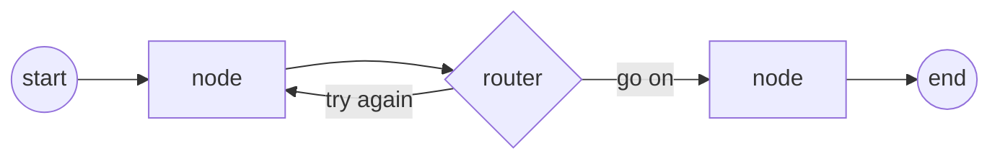
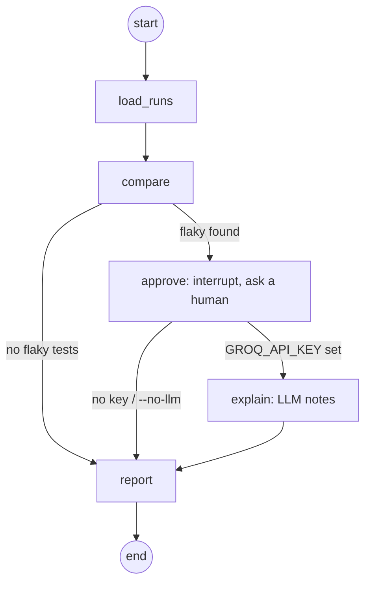

# Chapter 18 - LangGraph: Agents as a Map You Draw

Chapter 5 drew agents with a mouse in LangFlow. Chapter 17 wrote them in plain Python with `create_agent`. This chapter opens the box: **LangGraph** is the engine underneath, and it lets you draw the exact path an agent takes, including the loops, forks and pauses a one-way flow can't express.

## The idea in one picture

Think of a board game.

| Board game | LangGraph | In a test suite |
|---|---|---|
| A square | **Node**: a Python function that does one job | "run the test", "parse the report" |
| An arrow | **Edge**: where to go next | setup, then execute |
| The backpack your piece carries | **State**: a dict every node can read and update | fixtures shared across steps |
| A fork with a sign | **Conditional edge**: a function that returns the next node's name | `if flaky: quarantine else: pass` |
| An arrow pointing back | **Loop** | retry up to 3 times |
| Save game | **Checkpointer**: state saved per `thread_id` | resume a long run where it stopped |
| "Ask a grown-up first" | **Interrupt**: pause for a human, resume later | approve before quarantining tests |

A node never returns the whole backpack. It returns only the keys it changed, and LangGraph merges them in.



## Visual guide (start here if you're new)

[`learning/index.html`](learning/index.html) explains all ten scripts and the capstone: one page per lesson, each with a real-world QA example and its illustration, the exact graph, the key points and the verified output. Open it in any browser, no server needed. `learning/langgraph-visual-guide.html` is the same guide in one self-contained file for sharing.

Two kinds of pictures: the graphs live in `learning/diagrams/` as Mermaid sources (`.mmd`, drawn with Mermaid's hand-drawn look) rendered by the `/diagram` skill into `.png`, `.svg` and an editable `.excalidraw`; the example illustrations in `learning/illustrations/` are drawn by Codex through the `/codex-imagegen` skill. To change a page's words, edit `LESSONS` in `learning/build.py` and run `python3 build.py`; to change a graph, edit its `.mmd` and re-render it with `/diagram`.

## LangFlow vs LangChain vs LangGraph

| | LangFlow (ch 5) | LangChain `create_agent` (ch 17) | LangGraph (ch 18) |
|---|---|---|---|
| You build it by | dragging boxes | calling one function | declaring nodes and edges |
| Loops | awkward | hidden inside the agent | first class |
| Who decides the path | the flow | the model | you, with the model's help where you choose |
| Pause for a human | no | no | `interrupt()` |
| Memory between runs | per session | via LangGraph | checkpointer + `thread_id` |

`create_agent` in chapter 17 is itself a LangGraph graph. Script `009` rebuilds it by hand so you can see the two nodes and one loop it's made of.

## Setup

```bash
cd chapter_18_LangGraph
python3 -m venv .venv && .venv/bin/pip install -r requirements.txt
cp .env.sample .env        # only needed for 008, 009 and the LLM notes in 010
cd src/chapters
../../.venv/bin/python 001_Hello_Graph.py
```

Tested with Python 3.12 and `langgraph==1.2.12`. Get a free Groq key at https://console.groq.com/keys.

## The scripts

| # | Script | Teaches | Key? |
|---|---|---|---|
| 001 | `001_Hello_Graph.py` | State, one node, `START`/`END`, `compile`, `invoke`, printing the graph as Mermaid | no |
| 002 | `002_Linear_Pipeline.py` | Partial updates, `stream(stream_mode="updates")` to watch each step | no |
| 003 | `003_Conditional_Edge.py` | `add_conditional_edges`: route passed / failed / flaky to different nodes | no |
| 004 | `004_Loop_Retry.py` | A loop with a hard cap: flaky vs broken vs stable test | no |
| 005 | `005_Parallel_Reducer.py` | Fan-out, fan-in, and why parallel writes need a reducer | no |
| 006 | `006_Checkpointer_Memory.py` | `InMemorySaver`, `thread_id`, `get_state`, separate sessions | no |
| 007 | `007_Human_In_The_Loop.py` | `interrupt()` and `Command(resume=...)` | no |
| 008 | `008_LLM_Node.py` | An LLM inside a node with structured output; its answer drives the fork | yes |
| 009 | `009_ReAct_Agent_Tools.py` | The agent loop by hand: `bind_tools`, `ToolNode`, `tools_condition` | yes |
| 010 | `010_Flaky_Analyzer_Graph.py` | Capstone: chapter 5's flaky analyzer with a fork, an approval pause and optional LLM notes | optional |

Helpers: `llm.py` (loads `.env`, builds the Groq model), `playwright_results.py` (parses a Playwright JSON report).

### Expected output highlights

- **004**: `login_redirect` passes on attempt 3 -> `FLAKY`; `checkout_pay` fails 3/3 -> `REAL FAILURE`.
- **005**: all three suites land in `results`; the no-reducer version raises `InvalidUpdateError: At key 'results': Can receive only one value per step`.
- **006**: `nightly-regression` remembers 3 runs, `smoke` has 1.
- **008**: `checkout_pay` -> `product_bug`, `login_button` -> `test_bug`, `search_results` -> `environment`.
- **010**: on the chapter 5 sample, `FLAKY TEST COUNT: 1` and 2 consistent failures, the same answer as the LangFlow flow.

## The capstone graph (010)



```bash
cd src/chapters
../../.venv/bin/python 010_Flaky_Analyzer_Graph.py                # chapter 5 sample, asks you
../../.venv/bin/python 010_Flaky_Analyzer_Graph.py --yes          # auto-approve
../../.venv/bin/python 010_Flaky_Analyzer_Graph.py <folder> --no  # your own result1/result2.json
../../.venv/bin/python 010_Flaky_Analyzer_Graph.py --yes --no-llm # skip the LLM even with a key
```

The count is computed in Python, never by the model. The LLM node only adds likely causes and a first fix, so switching it on can't change the number a CI gate would read.

## Capstone: Jira requirement to a tested report

[`capstone/`](capstone/README.md) puts every lesson together. It takes a Jira ticket (via the Atlassian MCP or the REST API), analyses it, writes a test plan and cases, reviews them with rules plus an LLM, runs them with Playwright on TTACart, triages each failure and sends an HTML report. `worker.py` does the same for every ticket a JQL query finds, 24x7, with cron, systemd or GitHub Actions. Six small files, stdlib-first, written to the Ponytail rules (reuse before writing, no new dependency without a reason).

```bash
cd capstone && ../.venv/bin/python check.py && ../.venv/bin/python pipeline.py VWO-105
```

## Q&A

- **Q: When should I reach for LangGraph instead of `create_agent`?** A: When you need to control the path: a retry loop with a cap, a step that must always run, a human approval, or a branch the model must not skip. For "model plus a few tools, answer the question", `create_agent` is enough.
- **Q: Where does the "agent" actually live?** A: In the router functions. A node does work; a conditional edge makes the decision. In `008` the model decides, but a plain Python router still owns the edge.
- **Q: Why does `interrupt()` need a checkpointer?** A: The graph stops mid-run and your process may even exit. The paused state has to be saved somewhere so `Command(resume=...)` on the same `thread_id` can pick it up.
- **Q: How do I stop a loop running forever?** A: Put the cap in state and check it in the router (`004`). As a backstop, pass `{"recursion_limit": 20}` in the config; LangGraph then raises `GraphRecursionError`. Don't rely on the default: in 1.2.12 it is 10007 steps (older docs say 25), which for an LLM loop means thousands of paid calls before anything stops it.

## What actually broke

- **A node's type hint silently changes the graph.** LangGraph reads a node's parameter annotation as its *input schema*. In `005`, a shared `summarize(state: State)` pointed at the reducer version of `State` while the second graph used a different class, and `add_node` failed with `Channel 'results' already exists with a different type` before the lesson could run. Leaving that node untyped fixed it.
- **Parallel nodes writing one key need a reducer.** Without `Annotated[list, operator.add]`, fan-out raises `InvalidUpdateError` instead of picking a winner. That's the design, not a bug: you have to say how values combine.
- **The default recursion limit is not 25 any more.** Tested on 1.2.12, an unbounded loop ran to `Recursion limit of 10007 reached`. Set `recursion_limit` yourself on anything with a model in the loop.
- **Resume uses the same `thread_id`.** A new thread id starts a fresh run and the paused one is never resumed.
