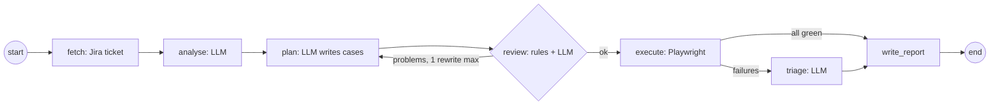

# Capstone: Jira requirement to a tested HTML report

Give it a Jira ticket. It reads the requirement, writes a test plan and test cases, has them reviewed, runs them in a real browser on [TTACart](https://app.thetestingacademy.com/playwright/ttacart/), works out *why* each failure happened, and sends you one HTML report. Point it at a JQL query and it does this for every new ticket, 24x7.

It's one LangGraph with seven nodes, built only from ideas in lessons 001-010.



## Six small files, one job each

| File | Lines | Job |
|---|---|---|
| `pipeline.py` | ~210 | The LangGraph: seven nodes and the edges between them |
| `executor.py` | ~90 | Runs test steps with Playwright; refuses anything not in TTACart |
| `jira.py` | ~60 | Fetch a ticket, search with JQL, add a label (Jira REST, stdlib only) |
| `report.py` | ~70 | One self-contained HTML report, optionally emailed |
| `worker.py` | ~35 | The 24x7 loop: JQL in, report out, label the ticket done |
| `check.py` | ~95 | The offline check: no LLM, no Jira, no internet |

`fixtures/VWO-105.json` is a real requirement (the TTACart PRD), pulled from Jira through the Atlassian MCP, so the whole flow runs in class with no Jira account.

## Setup

```bash
cd chapter_18_LangGraph
python3 -m venv .venv && .venv/bin/pip install -r capstone/requirements.txt
.venv/bin/python -m playwright install chromium
cp .env.sample .env          # add GROQ_API_KEY; the rest is optional
cd capstone
../.venv/bin/python check.py # should print: all checks passed
```

## Run it

```bash
../.venv/bin/python pipeline.py VWO-105          # plan, test, report
../.venv/bin/python pipeline.py VWO-105 --send   # ...and email the report
```

Each run writes a folder `reports/VWO-105-<date-time>/` with `report.html`, `plan.json` (the test cases) and a screenshot per failure. With no `JIRA_API_TOKEN` set, `fetch` reads `fixtures/<KEY>.json` instead of calling Jira.

## Two ways to get the requirement: MCP and API

**MCP, for people.** In Claude Code or Claude Desktop with the Atlassian connector, ask "get Jira issue VWO-105". Behind that are two MCP tools: `getAccessibleAtlassianResources` finds your site's cloud id, then `getJiraIssue` returns the ticket. Save the summary and description as `fixtures/VWO-105.json` in this shape:

```json
{"key": "VWO-105", "summary": "...", "description": "..."}
```

**API, for code.** A worker running at 3 a.m. can't click an OAuth login, so `jira.py` uses an API token over plain REST. Create one at id.atlassian.com > Security > API tokens and put `JIRA_URL`, `JIRA_EMAIL` and `JIRA_API_TOKEN` in `.env`.

## What each node does

| Node | In plain words |
|---|---|
| fetch | Get the ticket from Jira (or the fixture) |
| analyse | "What should be tested here?" as short bullets: features, acceptance criteria, risks |
| plan | 5 to 8 test cases, each a list of steps from a fixed vocabulary: `goto fill click select see "not see" count url` |
| review | Rules first: every page and element must really exist in TTACart. Then an LLM reviews like a senior QA: steps that contradict the app, untested acceptance criteria. Problems send the plan back once |
| execute | Playwright runs each case in a fresh browser (logged out, empty cart), with a screenshot on failure |
| triage | For each failure: `product_bug`, `test_bug`, `environment` or `flaky`, with a one-line reason |
| write_report | Results first, then failure analysis with screenshots, review notes, the plan and the analysis |

## Why the review has rules *and* an LLM

The test steps are written by a model, so they are untrusted input, just like a form field. `executor.problems()` checks every step against the real app map: the pages, the `data-test` ids on each, and the product ids. `goto` can only open TTACart pages, and the About and footer links (which leave the app) aren't allowed. A confused or prompt-injected plan can't click around the internet. The LLM reviewer catches what rules can't: a test that expects the cart badge to show "0" when TTACart removes it instead.

## Reading the report

- **test_bug**: the test expected something the app never does. Fix the test.
- **product_bug**: the app broke a rule from the ticket. File it.
- **environment**: the site or network failed. Rerun later.
- **flaky**: passes sometimes. TTACart's `error_user` does this on purpose.

Check the screenshot before you trust the category. In one run the model skipped the login step; the category said "the button never appears", and the screenshot showed the login page.

## Run it 24x7

The worker asks Jira for tickets matching a JQL query, runs the pipeline on each, and adds the label `qa-auto-done` **only after a finished run**, so a crash or a rate limit is simply retried next time. One bad ticket never stops the rest.

1. In Jira, add the label `qa-auto` to tickets you want tested.
2. The default query is `project = VWO AND labels = qa-auto AND labels != qa-auto-done ORDER BY created`. Change it with `JQL=` in `.env`.
3. Pick one way to keep it running:

**A. cron on any Mac or Linux machine.** Runs a pass every 15 minutes:

```bash
crontab -e
*/15 * * * * cd /path/to/chapter_18_LangGraph/capstone && ../.venv/bin/python worker.py >> worker.log 2>&1
```

**B. Always on, on a Linux server (systemd).** Save as `/etc/systemd/system/qa-worker.service`, then `sudo systemctl enable --now qa-worker`:

```ini
[Unit]
Description=QA capstone worker
After=network-online.target

[Service]
WorkingDirectory=/path/to/chapter_18_LangGraph/capstone
ExecStart=/path/to/chapter_18_LangGraph/.venv/bin/python worker.py --loop 15
Restart=always

[Install]
WantedBy=multi-user.target
```

**C. No server: GitHub Actions.** Add the `.env` values as repository secrets and save as `.github/workflows/qa-worker.yml`. The Jira label is the memory between runs, so nothing needs to persist on the runner:

```yaml
name: qa-worker
on:
  schedule: [{cron: "*/30 * * * *"}]
  workflow_dispatch:
jobs:
  run:
    runs-on: ubuntu-latest
    steps:
      - uses: actions/checkout@v4
      - uses: actions/setup-python@v5
        with: {python-version: "3.12"}
      - run: pip install -r chapter_18_LangGraph/capstone/requirements.txt && python -m playwright install --with-deps chromium
      - run: cd chapter_18_LangGraph/capstone && python worker.py
        env:
          GROQ_API_KEY: ${{ secrets.GROQ_API_KEY }}
          JIRA_URL: ${{ secrets.JIRA_URL }}
          JIRA_EMAIL: ${{ secrets.JIRA_EMAIL }}
          JIRA_API_TOKEN: ${{ secrets.JIRA_API_TOKEN }}
          SMTP_HOST: ${{ secrets.SMTP_HOST }}
          SMTP_USER: ${{ secrets.SMTP_USER }}
          SMTP_PASSWORD: ${{ secrets.SMTP_PASSWORD }}
          REPORT_TO: ${{ secrets.REPORT_TO }}
      - uses: actions/upload-artifact@v4
        if: always()
        with: {name: qa-reports, path: chapter_18_LangGraph/capstone/reports/}
```

**Budget before you schedule.** One ticket used about 16,000 LLM tokens in testing on `gpt-oss-20b`; `gpt-oss-120b` writes longer plans, so budget more. Groq's free tier allows 200,000 tokens a day per model, so roughly 10 tickets a day. Past that, Groq answers `429` and the worker retries those tickets on the next pass. For more, use a paid Groq tier or schedule less often.

## Settings (`chapter_18_LangGraph/.env`)

| Variable | Needed for | Example |
|---|---|---|
| `GROQ_API_KEY` | every run | `gsk_...` |
| `LLM_MODEL` | optional | `openai/gpt-oss-120b` (default). `openai/gpt-oss-20b` works but writes weaker tests |
| `JIRA_URL` `JIRA_EMAIL` `JIRA_API_TOKEN` | live Jira, the worker | `https://bugzz.atlassian.net` |
| `JQL` | the worker | see above |
| `TTA_URL` | optional | a staging copy of TTACart |
| `SMTP_HOST` `SMTP_PORT` `SMTP_USER` `SMTP_PASSWORD` `REPORT_TO` | `--send`, the worker | `smtp.gmail.com`, `465`, a Gmail app password |

## Deliberate limits

- **Steps come from a fixed vocabulary.** It can't resize the window, compare screenshots or measure time; the plan lists those as manual risks. To add one, add a `case` in `executor._do()` and a word to `Step.do`.
- **One rewrite after review.** Leftover review notes are printed in the report instead of looping forever.
- **The worker's memory is a Jira label**, so any machine can run it, and your team can see in Jira which tickets were tested.

## When something breaks

| You see | It means |
|---|---|
| `Jira said 401` or `404` on a real ticket | The API token expired. Make a new one |
| `Error code: 429` | Groq's daily or per-minute token limit. Wait, or use another model |
| A case marked `skipped` | The review rules refused a step, for example an element that doesn't exist |
| `Timeout 8000ms exceeded` on step 1 or 2 | The site is down, or `TTA_URL` is wrong |
